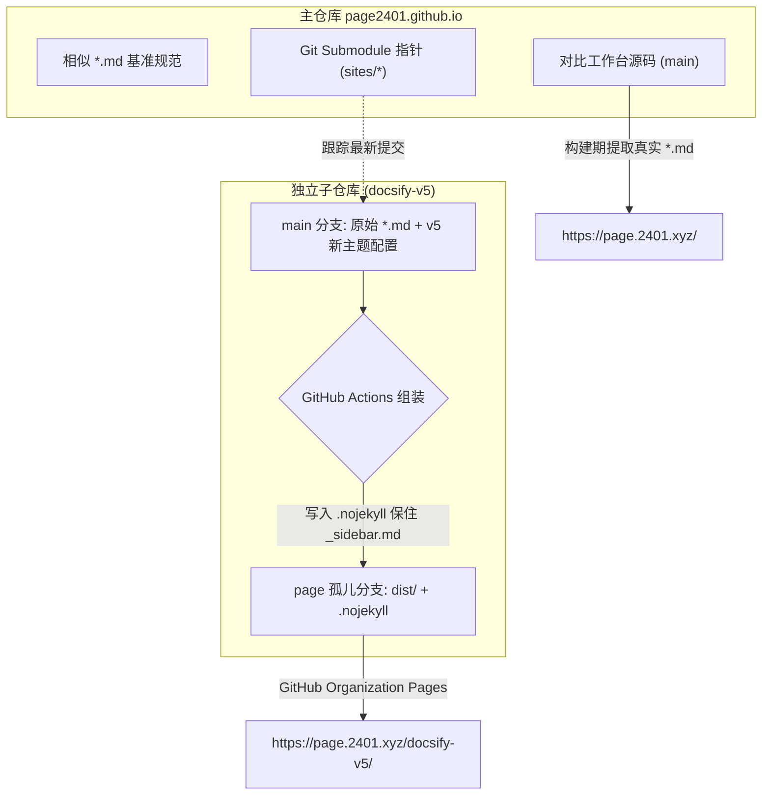
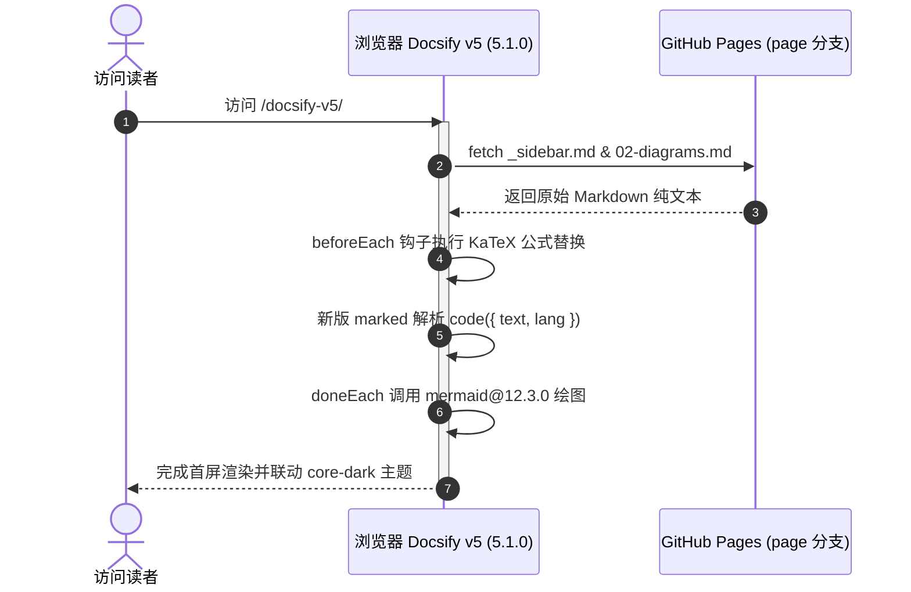
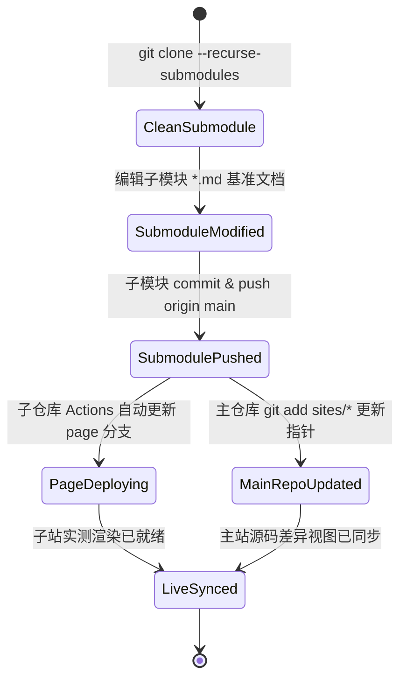

# 02. 流程图与时序图（Mermaid 12 · `docsify@5.1.0`）

> [!WARNING]
> **Docsify v4 -> v5 重大破坏性变更实录**：
> 在 v4 中覆写代码块渲染器的签名为 `code(code, lang)`（两个字符串参数）；而在 `docsify@5.1.0` 中底层升级了新版 `marked`，入参变更为单个 Token 对象 **`code({ text, lang })`**！若直接复制 v4 的配置代码到 v5，所有图表源码都会变成字符串 `"[object Object]"` 导致渲染报错。

## 1. 复杂子图与架构流程图（`flowchart TD`）

## 2. 运行时拉取渲染时序图（`sequenceDiagram`）

## 3. 子模块同步状态机（`stateDiagram-v2`）

